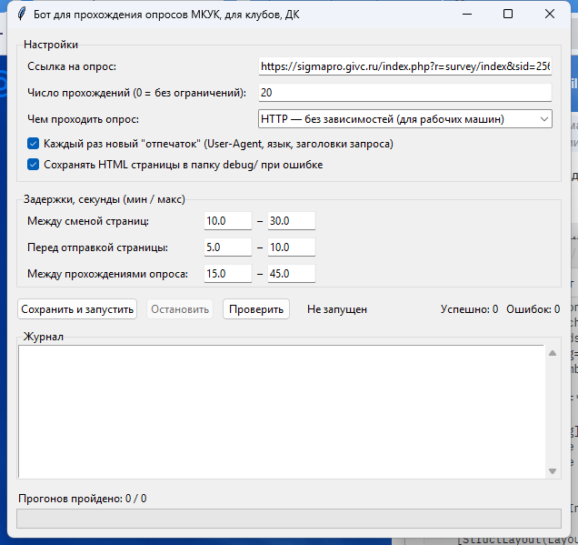
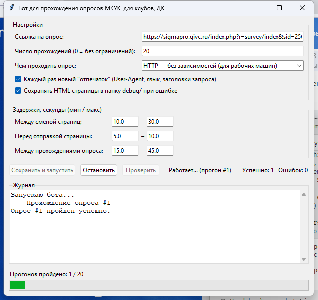

# Опрос-бот (SigmaPro / LimeSurvey)

Вы работаете Доме Культуры \ сельском клубе \ прочем культурном учреждении, и уже устали проходить даунские опросы? Вам поможет этот проект. Он проходит опрос по ссылке, выбирая хорошие варианты ответа.

Бот на Python, который самостоятельно и раз за разом проходит скучный опрос на сайте на движке SigmaPro (LimeSurvey) — со случайными паузами между действиями и «свежей» сессией на каждый прогон, чтобы не выглядеть как спам-скрипт.

Управление — через простое окно (tkinter): ссылка на опрос, задержки, число прогонов, кнопки «Запустить»/«Остановить» и живой журнал происходящего.



## Ничего не нужно устанавливать

Боту достаточно самого Python — **никаких сторонних пакетов, никаких загрузок**. Он не ставит `pip`-зависимостей и не скачивает браузер: страницы опроса запрашиваются напрямую через `urllib` из стандартной библиотеки, а HTML разбирается своим маленьким парсером на `html.parser`.

Это сделано намеренно: на многих рабочих компьютерах установка Playwright и Chromium не проходит из-за региональных блокировок. Единственный сайт, к которому обращается бот, — сам опрос.

## Что делает бот

- открывает опрос и проходит по всем его страницам, заполняя вопросы по заранее заданным правилам;
- на каждый новый прогон заводит чистую сессию (без cookie от прошлых запусков) со случайным User-Agent и заголовками запроса;
- умеет повторять прохождение нужное число раз (или бесконечно), со случайными задержками между действиями;
- всё это настраивается визуально — не нужно редактировать код или JSON руками.

## Быстрый старт (Windows)

1. Скачайте/склонируйте репозиторий.
2. Установите [Python 3.9+](https://www.python.org/downloads/) — при установке обязательно поставьте галочку **Add Python to PATH**.
3. Запустите `start.bat` двойным щелчком — откроется окно бота.
4. В окне проверьте/поправьте настройки и нажмите **«Сохранить и запустить»**.

> На macOS/Linux двойного клика по `.bat` не будет — запустите `python launcher.py` (или сразу `python gui.py`) из терминала.



## Настройки в окне бота

| Поле | Что означает |
|---|---|
| Ссылка на опрос | URL опроса. Может со временем меняться — структура вопросов, по опыту, нет. |
| Чем проходить опрос | `HTTP` — обычный режим, без зависимостей. `Браузер` — для проверки глазами, нужен Playwright (см. «Браузерный режим»). |
| Число прохождений | Сколько раз подряд пройти опрос. `0` — без ограничения, бот работает, пока не нажмёте «Остановить». |
| Новый «отпечаток» | При каждом прогоне менять User-Agent, язык и прочие заголовки запроса. |
| Сохранять HTML при ошибке | Если прогон завершился ошибкой — сохранять HTML страницы в папку `debug/` (см. «Диагностика проблем» ниже). Можно отключить, когда бот уже настроен и стабильно работает. |
| Задержки (мин / макс, сек) | Случайное время ожидания: между сменой страниц опроса, перед отправкой заполненной страницы, между двумя прохождениями подряд. |

Настройки сохраняются в `config.json` — его можно редактировать и вручную, без GUI.

Кнопка «Остановить» прерывает работу сразу: страница, которую бот не успел отправить, не отправляется вовсе, и такой незавершённый прогон не попадает в счётчики.

## Кнопка «Проверить»

Проверяет, что бот отвечает так, как задумано. Он проходит опрос один раз и открывает в браузере отчёт: каждая страница, каждый вопрос, все варианты ответа — и галочкой отмечено то, что выбрал бот. Для табличного вопроса показана вся таблица с подсвеченной оценкой в каждой строке.

Отчёт складывается в `preview/report.html`, рядом лежит исходный HTML каждой страницы (`page1.html`, `page2.html`, …) — на случай, если понадобится посмотреть разметку, когда опрос изменится.

Отчёт строится наблюдением за настоящим прогоном: правила ответов не продублированы, показывается ровно то, что бот сделал.

> **Проверка отправляет один ответ.** Пройти опрос «вхолостую» не получится: сайт не даёт распознать последнюю страницу заранее — на всех шагах одинаковая кнопка «Продолжить» с одинаковым значением, классом и полосой прогресса. Так что бот честно проходит опрос целиком, как при обычном прогоне.

## Браузерный режим (необязательный)

Обычный режим ничего не показывает — он общается с сайтом напрямую. Если хочется посмотреть, как опрос заполняется в настоящем браузере, переключите «Чем проходить опрос» на **Браузер**. Работает и с кнопкой «Проверить», и с обычным запуском.

Правила ответов при этом те же самые: страница читается той же моделью, решение принимает та же функция, а браузер только кликает. Расхождения между режимами быть не может.

**Что нужно.** Пакет Playwright (~37 МБ) — и всё. Свой Chromium (ещё ~450 МБ) не нужен: режим использует уже установленный **Microsoft Edge** (входит в Windows 10/11) или **Google Chrome**.

**Как поставить на машине без доступа в интернет:**

1. На машине, где `pip` работает (при необходимости — с VPN), выполните:
   ```
   python tools/fetch_vendor.py 3.10 3.11 3.12
   ```
   Аргументы — версии Python на целевых машинах: пакет `greenlet` собирается под каждую версию отдельно, остальное универсально. Без аргументов колёса скачаются только под текущий Python.
2. Скопируйте папку проекта вместе с появившейся `vendor/` на нужную машину.
3. Выберите браузерный режим и нажмите «Проверить» — Playwright установится из `vendor/` без обращения к сети.

Тонкая настройка — в `config.json`, секция `browser`: `channel` (`auto`, `msedge`, `chrome` или `chromium`) и `headless` (скрывать ли окно). При `auto` берётся первый доступный: Edge, затем Chrome, затем скачанный Chromium, если он есть.

Папка `vendor/` не входит в репозиторий — это локальные бинарные файлы.

## Как бот отвечает на вопросы

Правила ответов зашиты в `bot/rules.py` под конкретную структуру этого опроса: для одних вопросов задан фиксированный ответ, для других (пол, возраст) — случайный выбор среди вариантов, для табличного вопроса — фиксированная оценка «5» в каждой строке, кроме последней, где ответ случайный между «5» и «Затрудняюсь ответить».

Вопросы бот ищет по вёрстке страницы (`.question-container`), а нужный вариант — по тексту подписи, поэтому правила не завязаны на внутренние коды полей LimeSurvey. Если понадобится приспособить бота под другой опрос или изменившуюся вёрстку — правьте правила в `bot/rules.py`, а селекторы (если поменяются классы) — в `bot/page.py`.

## Как это работает внутри

Опрос полностью отрисовывается на сервере: страница подтверждения организации — обычная ссылка, а сами вопросы — обычная HTML-форма с `method="post"`. Браузер и JavaScript для прохождения не нужны, поэтому бот делает ровно то же, что делал бы браузер:

1. запрашивает страницу опроса и получает cookie сессии;
2. переходит по ссылке «Продолжить» на экране подтверждения организации;
3. на каждом шаге забирает из формы служебные скрытые поля (`LEMpostKey`, `thisstep`, `fieldnames`, `relevance*` и прочие), добавляет к ним выбранные ответы и отправляет всё это POST-запросом;
4. повторяет, пока не увидит страницу завершения опроса.

Если сайт не принял страницу (например, остался неотвеченный обязательный вопрос), он возвращает её же с пометкой `input-error` на проблемных вопросах — бот это замечает и сообщает об ошибке, а не крутится в цикле.

## Структура проекта

```
├── start.bat          # точка входа для Windows — двойной клик запускает всё
├── launcher.py         # проверяет Python и открывает GUI
├── gui.py                # окно настроек/запуска/журнала (tkinter)
├── config.json            # настройки бота (можно редактировать вручную)
├── bot/
│   ├── survey_bot.py          # основной цикл прохождения опроса
│   ├── rules.py                 # правила ответов на конкретные вопросы
│   ├── page.py                    # модель страницы LimeSurvey: форма, вопросы, варианты
│   ├── session.py                   # HTTP-сессия: cookie, заголовки, повторы при обрыве связи
│   ├── dom.py                         # маленький разбор HTML поверх стандартного html.parser
│   ├── profile.py                       # рандомизация «отпечатка» (заголовков запроса)
│   ├── preview.py                         # режим проверки: прогон с записью каждого выбора
│   ├── report.py                            # сборка HTML-отчёта о проверке
│   └── browser_bot.py                         # необязательный движок на Playwright
├── tools/
│   └── fetch_vendor.py                          # скачивает колёса Playwright в vendor/
├── debug/                                         # HTML страницы при ошибке (создаётся сам)
├── preview/                                         # отчёт о проверке (создаётся сам)
└── vendor/                                            # колёса Playwright для офлайн-установки
```

Зависимостей нет — весь код использует только стандартную библиотеку Python, поэтому файла `requirements.txt` в проекте тоже нет. Единственное исключение — необязательный браузерный режим, и он нужен лишь там, где вы проверяете бота, а не на рабочих машинах.

`pages/`, `debug/`, `preview/` и `vendor/` не входят в репозиторий (см. `.gitignore`) — это только локальные рабочие файлы: сохранённые HTML-снимки страниц опроса, использованные при разработке, и отладочные снимки при ошибках.

## Диагностика проблем

- **Бот пишет «Сайт не принял ответы на вопросы».** Вёрстка или состав вопросов опроса изменились. Проверьте папку `debug/` — туда бот при ошибке сохраняет HTML страницы, на которой застрял; по нему будет видно, что не так.
- **«Не нашёл вариант ответа ...».** В опросе переименовали или убрали вариант, на который завязано правило в `bot/rules.py` — поправьте текст в правиле.
- **«Не удалось связаться с сайтом опроса».** Бот сам делает несколько попыток с паузами; если не помогло — проблема с интернетом или сайт опроса недоступен.
- **«Браузерный режим требует пакет Playwright».** Соберите папку `vendor/` через `tools/fetch_vendor.py` на машине с интернетом и скопируйте её сюда — см. «Браузерный режим».
- **«Не удалось запустить ни один браузер».** На машине нет ни Edge, ни Chrome. Установите любой из них или выполните `python -m playwright install chromium`.
- **Окно бота не открывается, ошибка про tkinter.** Переустановите Python стандартным установщиком с python.org — модуль tkinter входит в него по умолчанию.

## Ответственное использование

Бот создан для автоматизации личного, рутинного прохождения одного и того же опроса на нескольких устройствах. Используйте его в соответствии с условиями конкретного сайта и на свой страх и риск.
